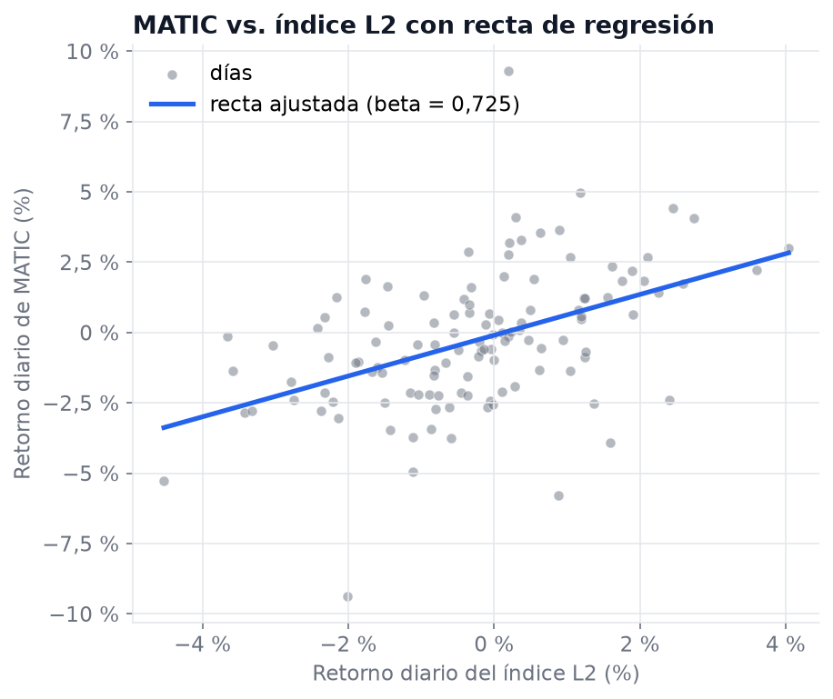

# Radar de Layer 2

**¿Cuánto se mueve MATIC (Polygon) cuando se mueve el mercado L2, y sirve esa relación para algo?**

Reto de Minería de Datos. Se mide la *beta* de MATIC frente a un índice de tokens Layer 2, se valida con datos que el modelo nunca vio y se usa para un escenario de estrés y un sistema de alertas.

**Demo en vivo:** `https://<tu-usuario>.github.io/radar-layer2/` *(reemplaza `<tu-usuario>` cuando actives GitHub Pages, ver [GUIA.md](GUIA.md))*

---

## Resultados

| | Resultado |
|---|---|
| **Datos** | 120 días (1-mar a 28-jun-2023), 6 columnas, 0 nulos, 0 duplicados, fechas sin saltos |
| **Beta** | Por cada **1 %** que se mueve el mercado L2, MATIC se mueve en promedio **0,72 %** |
| **Correlación / R²** | 0,46 / 0,21: el índice L2 explica el 21 % del movimiento diario de MATIC |
| **Validación (90 / 30 días)** | RMSE 0,0168 frente a 0,0182 de "predecir 0": el modelo **gana por 7,5 %** (mejora modesta) |
| **Escenario** | Si L2 cae 10 %, MATIC cae ≈ **7,2 %** (es extrapolación: el peor día real de L2 fue −4,53 %) |
| **Alertas** | **4 días** con \|residuo\| > 2σ; los dos extremos son el **10-abr-2023** (+9,3 %) y el **25-may-2023** (−9,4 %) |
| **Bonus (BTC)** | R² ajustado 0,207 → 0,221, pero L2 y BTC tienen correlación 0,72 (multicolinealidad) |
| **Limitación** | La prueba tiene solo 30 días: al remuestrear, la mejora va de −15 % a +24 % |



---

## Estructura del proyecto

```
radar-layer2/
├── data/
│   └── dataset_reto_l2.csv        # Dataset del reto (120 días)
├── notebooks/
│   └── reto_radar_l2.ipynb        # Los 5 pasos + bonus, con respuestas escritas
├── src/
│   └── analisis.py                # El mismo análisis como script reproducible
├── excel/
│   └── reto_radar_l2.xlsx         # Versión Excel con las fórmulas de la guía
├── reports/
│   ├── informe.md                 # Informe completo
│   ├── resultados.json            # Todas las cifras (lo genera analisis.py)
│   └── figures/                   # Gráficos (los genera analisis.py)
├── docs/                          # Demo web (HTML + CSS + JS) → GitHub Pages
│   ├── index.html
│   ├── css/styles.css
│   └── js/
│       ├── data.js                # Dataset embebido
│       └── app.js                 # Cálculos y gráficos
├── presentacion/                  # Diapositivas exportadas (PDF / PPTX)
├── requirements.txt
├── GUIA.md                        # Paso a paso: VS Code, GitHub y GitHub Pages
└── README.md
```

## Cómo ejecutarlo

```bash
# 1. Crear y activar un entorno virtual
python -m venv .venv
# Windows:
.venv\Scripts\activate
# macOS / Linux:
source .venv/bin/activate

# 2. Instalar dependencias
pip install -r requirements.txt

# 3. Reproducir todo el análisis (genera reports/figures y reports/resultados.json)
python src/analisis.py
```

- **Notebook:** abre `notebooks/reto_radar_l2.ipynb` en VS Code, elige el kernel `.venv` y pulsa *Run All*.
- **Demo web:** abre `docs/index.html` con doble clic (funciona sin internet) o visita la página de GitHub Pages.
- **Excel:** abre `excel/reto_radar_l2.xlsx`. Las fórmulas están en las celdas que pide la guía (L1–L14, G/H/I 92–121, M/N 2–121).

## Método

1. **Entender y limpiar:** forma, tipos, nulos, duplicados y fechas consecutivas. La primera fila tiene `ret_indice_l2 = 0.0` (probable relleno); se mantiene porque quitarla mueve la beta menos de 0,001.
2. **Explorar:** precio en el tiempo, dispersión de retornos y correlación.
3. **Medir la beta:** `ret_matic = alpha + beta · ret_indice_l2` con mínimos cuadrados (`np.polyfit`, X = L2, Y = MATIC).
4. **Validar a ciegas:** beta con los primeros 90 días, RMSE en los últimos 30 y comparación con la línea base "predecir 0". Se añade un remuestreo (bootstrap) para medir qué tan estable es la mejora.
5. **Usarlo:** (A) escenario L2 −10 %; (B) alertas con residuo = `ret_matic − beta · ret_indice_l2` y umbral de 2σ.

**Bonus:** regresión con dos factores (L2 + BTC), R² ajustado, RMSE de prueba y multicolinealidad.

## Herramientas

Python 3 · pandas · numpy · matplotlib · Jupyter · Excel · HTML, CSS y JavaScript (sin librerías: los gráficos están hechos con SVG a mano).

> El dataset es **sintético**, creado para el reto con la estructura de un análisis real. Las cifras no describen el mercado real.
