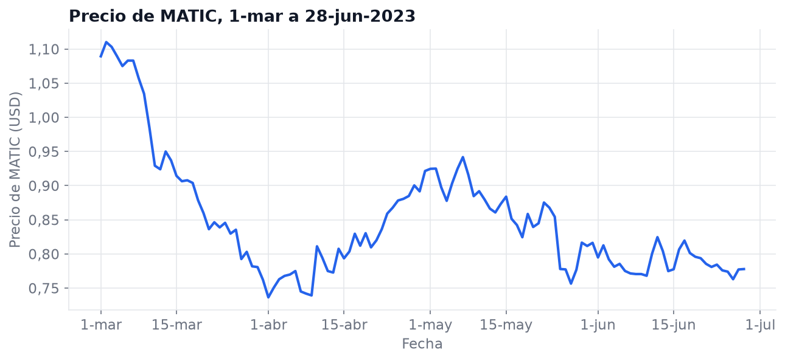
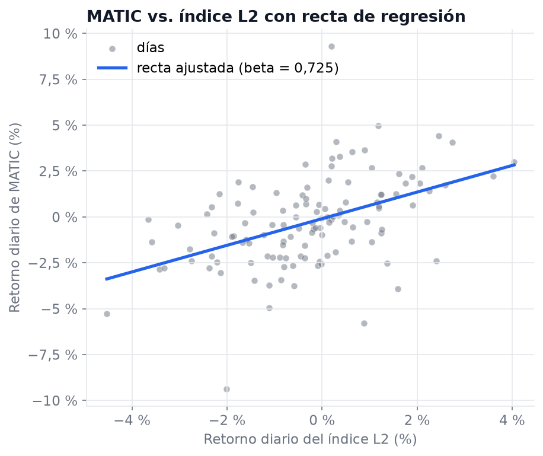
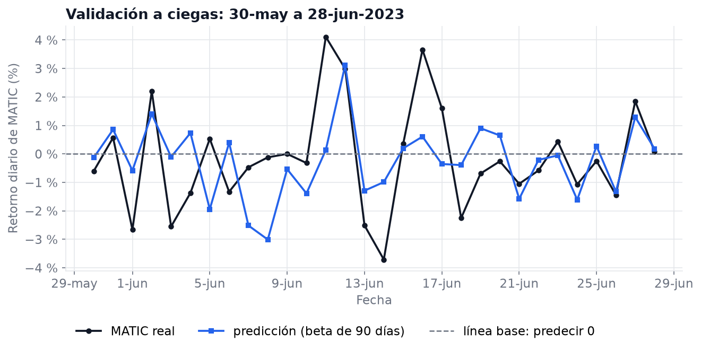
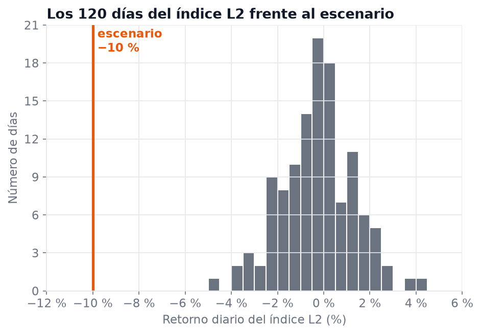
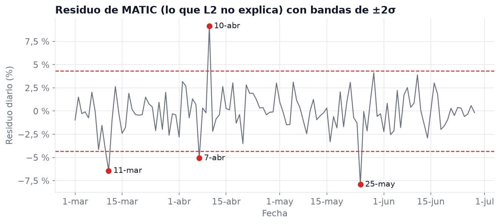
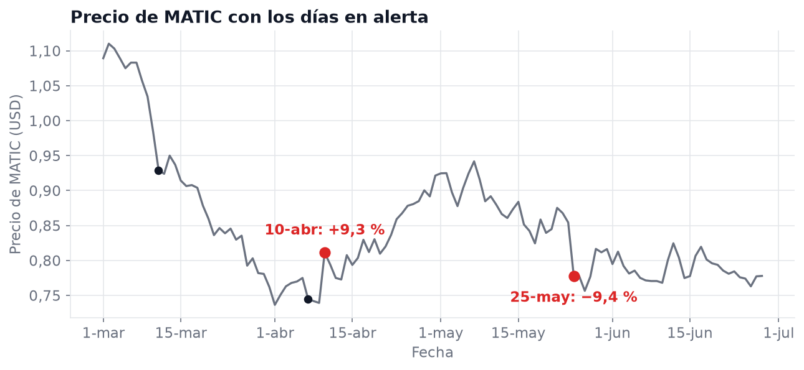

# Informe: Radar de Layer 2 (MATIC vs. mercado L2)

Por cada 1 % que se mueve el mercado L2, MATIC se mueve en promedio **0,72 %**. La relación es real pero moderada (R² = 0,21), y como predictor diario le gana a "predecir 0" solo por un **7,5 %**.

## Resumen

| Sección | Resultado |
|---|---|
| **Mi beta** | Por cada 1 % que se mueve el mercado L2, MATIC se mueve en promedio **0,72 %**. La correlación es **0,46** y el R² es **0,21**. |
| **Validación** | Con beta calculada solo con 90 días, el RMSE en los 30 días de prueba fue **0,0168** frente a **0,0182** de la línea base (predecir 0). Mi modelo **gana** por **7,5 %**. |
| **Uso práctico** | (Escenario) Si L2 cae 10 %, MATIC cae ≈ **7,2 %**. (Alertas) Encontré **4** días con \|residuo\| > 2σ, entre ellos **10-abr-2023** y **25-may-2023**. |
| **Limitación** | Una limitación importante es que **la prueba tiene solo 30 días**, porque con tan pocos días la mejora de 7,5 % no es estable: al remuestrear va de −15 % a +24 % y en 1 de cada 5 casos el modelo no gana. |

## Paso 1. Entender y limpiar

Los datos están completos y bien tipados: 120 filas y 6 columnas, sin nulos, sin duplicados y con fechas consecutivas cada 1 día, del 1-mar-2023 al 28-jun-2023.

- **Tipos:** `fecha` se lee como fecha; las otras 5 columnas son numéricas (decimales).
- **Coherencia:** `ret_matic` coincide con ln(precio_hoy / precio_ayer); la diferencia máxima es 0,00014 (redondeo a 4 decimales).
- **Valor llamativo:** el 1-mar-2023, `ret_indice_l2` vale 0.0 exacto. Es el único cero exacto de los 120 días y es el primer día, sin día anterior para calcular un retorno: probablemente un relleno.

**Decisión: la fila 1 se deja.** Un 0 es neutro, quitarla mueve la beta de 0,7248 a 0,7256 (menos de 0,001), y la guía trabaja con 120 filas (rangos 2:121 y corte 90/30).

| Columna | Qué es y en qué unidad |
|---|---|
| `fecha` | Día de la observación (frecuencia diaria). |
| `precio_matic` | Precio de MATIC en dólares (USD); va de 0,7365 a 1,1102. |
| `ret_matic` | Retorno diario logarítmico de MATIC, en decimal (0.01 = 1 %). |
| `ret_indice_l2` | Retorno diario del índice L2 (mediana de tokens L2), en decimal. |
| `ret_btc` | Retorno diario de Bitcoin, en decimal. |
| `volumen_musd` | Volumen negociado en millones de USD por día (44,4 a 89,3). |

## Paso 2. Explorar

La correlación entre `ret_indice_l2` y `ret_matic` es **0,462**: positiva y **moderada**. La dispersión es una nube inclinada hacia arriba, no una línea.

MATIC baja de 1,09 USD a 0,78 USD en el periodo (−29 %), con el mínimo el 1-abr-2023 (0,7365 USD). Se ven dos saltos bruscos: una subida el 10-abr y una caída el 25-may.

## Paso 3. Medir la beta

La recta ajustada con los 120 días es `ret_matic = −0,00097 + 0,725 × ret_indice_l2`, con **R² = 0,214**.

| Medida | Valor | Python | Excel |
|---|---|---|---|
| beta | 0,725 | `np.polyfit(x, y, 1)[0]` | `=PENDIENTE(C2:C121;D2:D121)` |
| alpha | −0,00097 | `np.polyfit(x, y, 1)[1]` | `=INTERSECCION.EJE(C2:C121;D2:D121)` |
| correlación | 0,462 | `x.corr(y)` | `=COEF.DE.CORREL(D2:D121;C2:C121)` |
| R² | 0,214 | `corr ** 2` | `=COEFICIENTE.R2(C2:C121;D2:D121)` |

X = `ret_indice_l2` (el mercado) e Y = `ret_matic`. Con los ejes invertidos saldría 0,295, que responde otra pregunta.

- **¿Cuánto se mueve MATIC por cada 1 % de L2?** En promedio **0,72 %** en la misma dirección. Con beta < 1, MATIC es algo menos sensible que el índice L2 en estos datos.
- **¿Qué no explica el índice L2?** El índice explica el 21 % de la variación diaria de MATIC. El 79 % restante viene de factores propios de MATIC (noticias, eventos del proyecto, ruido).
- La beta es una estimación: su error estándar es 0,13, así que un rango razonable (95 %) va de 0,47 a 0,98.

## Paso 4. Validar a ciegas

Con datos que nunca vio, el modelo le gana a "predecir siempre 0" por un **7,5 %**: una mejora real pero modesta.

- **Entrenamiento:** días 1 a 90 (1-mar a 29-may-2023). **Prueba:** días 91 a 120 (30-may a 28-jun-2023).
- **Beta solo con entrenamiento:** 0,795 (alpha = −0,00099), parecida a la de 120 días.

| Predicción en los 30 días de prueba | RMSE |
|---|---|
| Modelo: alpha + beta × L2 | 0,01682 |
| Línea base: predecir 0 | 0,01819 |
| Mejora: 1 − RMSE modelo / RMSE base | 7,5 % |

**¿Es grande la diferencia? No.** El modelo se acerca más que la línea base en 17 de 30 días. Al remuestrear 5000 veces los 30 días, la mejora va de −15 % a +24 % (95 %), y en 1 de cada 5 remuestreos el modelo no gana. Además, el modelo usa el retorno de L2 del mismo día, que en la práctica no se conoce por adelantado.

Como control, calcular la beta con los 120 días daría una mejora de 9,0 %; ese número no vale porque el modelo ya habría visto los días de prueba.

## Paso 5. Usarlo

### Opción A: escenario

Si el mercado L2 cae 10 %, el modelo estima que MATIC cae **≈ 7,2 %** (0,725 × −0,10; en Excel `=L2*-0,10`).

Es una **extrapolación**: en 120 días L2 solo se movió entre −4,53 % (27-mar-2023) y +4,04 % (12-jun-2023). Un −10 % es 2,2 veces la peor caída observada y unas 6,4 desviaciones estándar.

### Opción B: alertas

Residuo = `ret_matic − beta × ret_indice_l2`. σ = 0,0216, umbral 2σ = 4,33 %. Hay **4 días en alerta**.

| Fecha | ret_matic | ret L2 | Residuo | Volumen (M USD) |
|---|---|---|---|---|
| **10-abr-2023** | +9,29 % | +0,20 % | **+9,15 %** | 89,3 |
| **25-may-2023** | −9,37 % | −2,01 % | **−7,91 %** | 81,9 |
| 11-mar-2023 | −5,80 % | +0,88 % | −6,44 % | 76,2 |
| 7-abr-2023 | −3,92 % | +1,59 % | −5,07 % | 79,8 |

- **10-abr:** MATIC sube 9,3 % con L2 casi plano. En el precio es un salto hacia arriba (de 0,739 a 0,811 USD) que rompe la tendencia bajista, con el volumen más alto del periodo.
- **25-may:** MATIC cae 9,4 % cuando L2 solo cayó 2 %. En el precio es una caída en escalón (de 0,854 a 0,778 USD) que borra la subida de mayo.

Los otros dos días son caídas de MATIC mientras L2 subía. Si se incluye alpha en el residuo salen las mismas 4 alertas.

## Bonus: segundo factor (BTC)

| Modelo | R² | R² ajustado | RMSE prueba (30 días) |
|---|---|---|---|
| Solo L2 | 0,214 | 0,207 | 0,01682 |
| L2 + BTC | 0,234 | 0,221 | 0,01605 |

Coeficientes con 120 días: alpha = −0,0015, b1 (L2) = 0,956, b2 (BTC) = **−0,374**. En Excel: `=ESTIMACION.LINEAL(C2:C121;D2:E121;VERDADERO;VERDADERO)` (coeficientes en orden inverso).

b2 sale negativo aunque MATIC y BTC tienen correlación positiva (0,23). La causa es que L2 y BTC tienen correlación **0,717**: **multicolinealidad**. Los coeficientes son inestables (con 90 días, b2 = −0,29) y pueden cambiar de signo, así que para comunicar el resultado se usa el modelo simple.

## Limitaciones

La limitación principal es que **la prueba tiene solo 30 días**: un par de días distintos podría convertir la mejora en una pérdida, y así pasa en 1 de cada 5 remuestreos. Además:

- **R² bajo (0,21):** el 79 % del movimiento diario de MATIC queda sin explicar.
- **La beta es incierta:** su rango razonable va de 0,47 a 0,98.
- **Extrapolación:** el escenario de −10 % está fuera de todo lo observado.
- **Mismo día:** el modelo usa el retorno de L2 del mismo día; explica, pero no anticipa.
- **Relación cambiante:** la beta pasó de 0,795 (90 días) a 0,725 (120 días).
- **Datos sintéticos:** el dataset fue creado para el reto.
